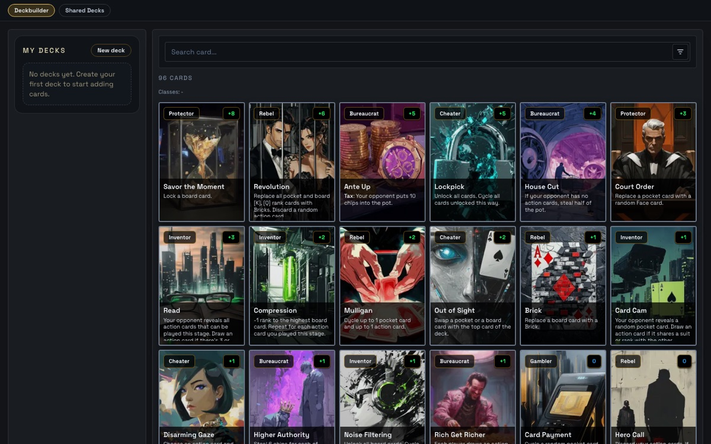
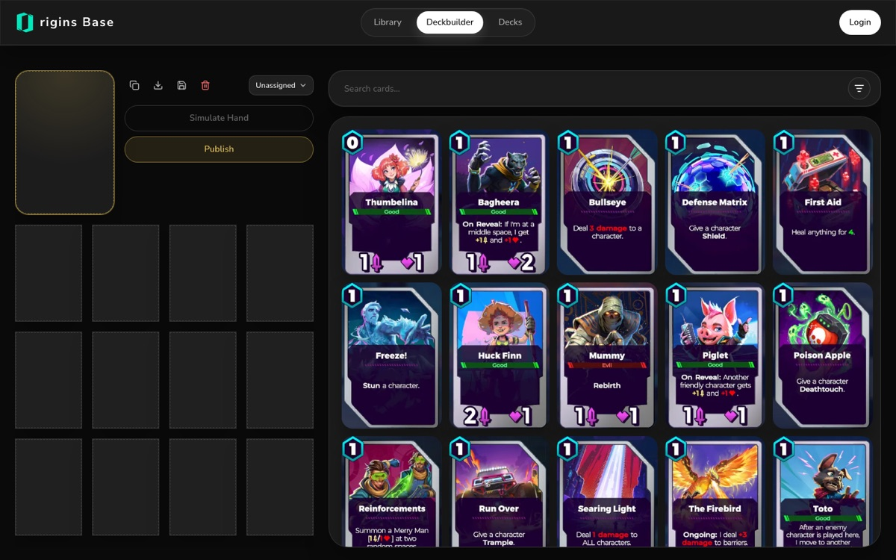
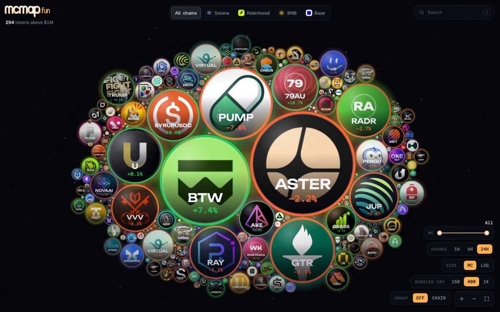
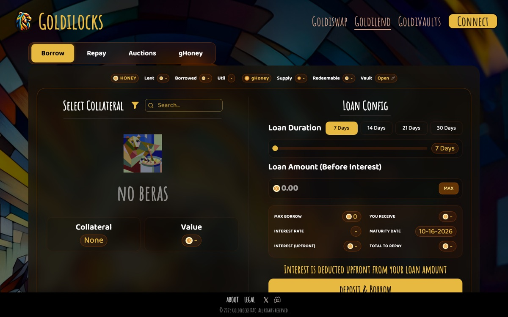
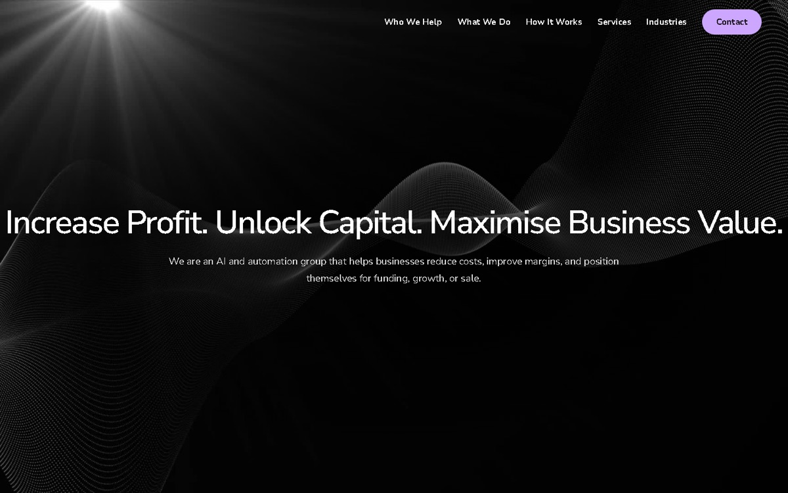
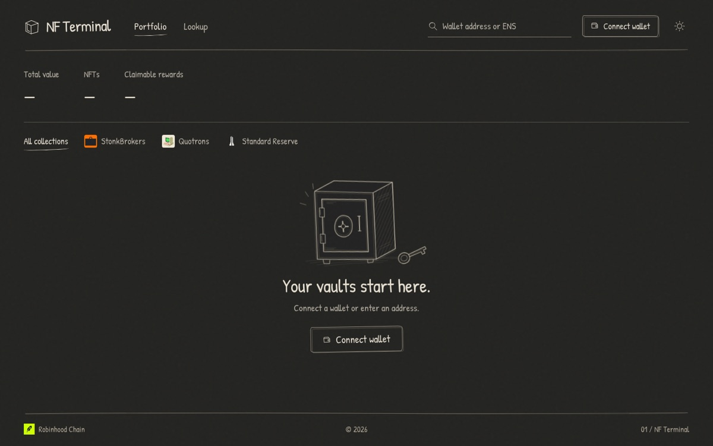
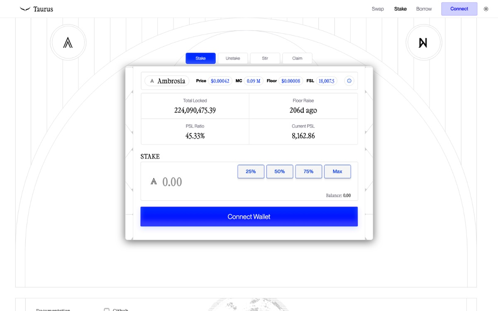

### Eclipse

<b><a href="https://showdown-deckbuilder.vercel.app">Showdown Deckbuilder</a></b> · deckbuilder for Showdown, a poker card game

 
Browse all 96 cards, filter by stage, class and rarity, save and share decks. 
Next.js · Convex · Tailwind · <a href="https://github.com/EclipseHW/showdown-deckbuilder">Code</a>
  

<b><a href="https://originsbase.com">Origins Base</a></b> · card library and deckbuilder for Origins TCG

 
Deck codes, a mulligan hand simulator and published decks with share images. 
Next.js · Convex · Clerk · <a href="https://github.com/EclipseHW/Origins">Code</a>
  

<b><a href="https://mcmap.fun">mcmap</a></b> · live bubble map of memecoins above $1M

 
Every token above $1M on Solana, Base, BNB Chain and Robinhood Chain, with the KOLs holding them. 
Next.js · PixiJS · Cloudflare Workers · Supabase
  

<b><a href="https://www.goldilocks.io/goldilend">Goldilend</a></b> · redesign of the Goldilocks NFT lending app

 
Borrow against Bera NFTs, repay, auctions and gHoney on Berachain. 
Next.js · Wagmi · Tailwind
  

<b><a href="https://protoform.tech">Protoform</a></b> · website for an AI and automation firm

 
Landing site for a firm that helps businesses cut costs and prepare for funding or sale. 
React · Vite · Tailwind · Framer Motion
  

<b><a href="https://nfterminal.vercel.app">NF Terminal</a></b> · NFT portfolio terminal for Robinhood Chain

 
Portfolio and collection browser for StonkBrokers, Quotrons and Standard Reserve. 
React · Wagmi · Convex
  

<b>Taurus</b> · DeFi frontend for the Ambrosia token

 
Swap, stake and borrow in one interface, with live protocol metrics. 
React · Wagmi · RainbowKit · viem
  

